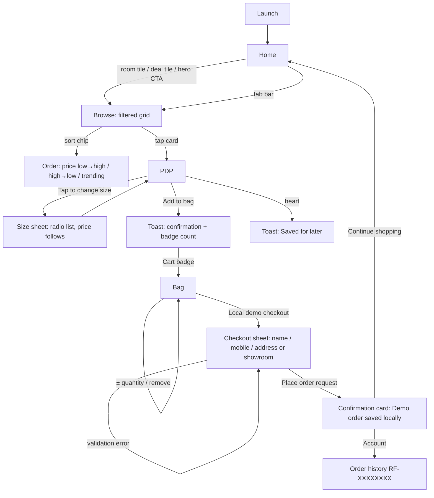
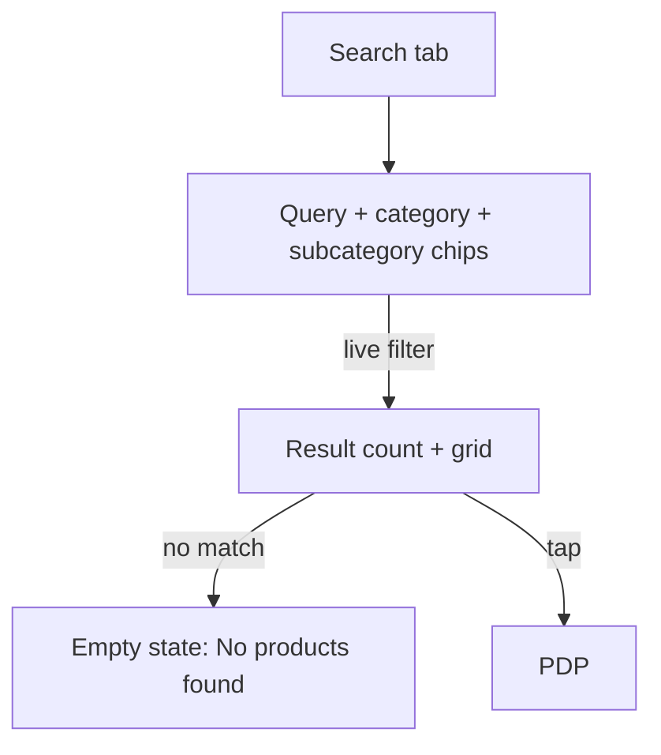
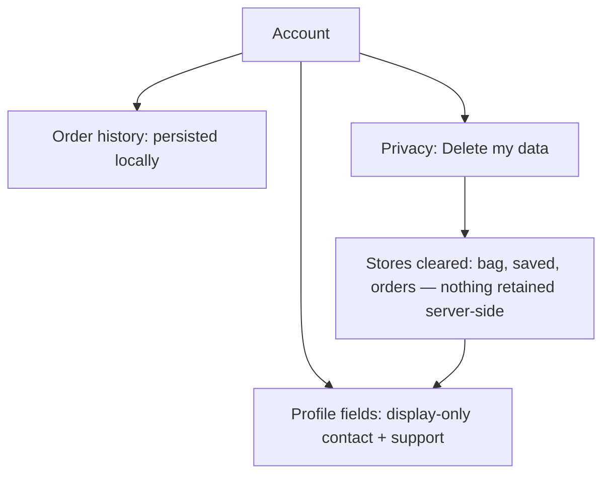

# Royal Furniture — UI/UX Design Refresh (v1)

**Scope:** visual & interaction refresh proposal for iOS / Android / Web (Expo, one codebase).
**Guardrails (per brief):** security modules, auth/payment flows, persistence and the
accessibility-label contract are **frozen** — this document never touches them. The label
contract is mechanically enforced by `__tests__` + `e2e/smoke.spec.ts` +
`scripts/maestro-flows.test.mjs`; any proposal here that renamed a label would fail CI,
so it can't happen silently.
**Mockups:** rendered high-fidelity frames in `docs/design/mockups/` (referenced inline).
**Everything else** (tokens, flows, wireframes, states, motion, WCAG) is grounded in the
shipped codebase — `components/catalog/kit.ts`, `app/ui/glass.tsx` — not invented.

---

## 1. Brand foundations

### 1.1 Palette (existing — unchanged)

| Token | Hex | Role |
|---|---|---|
| `red` | `#DA1921` | Brand accent: primary CTA, badges, active tab, eyebrows |
| `redDeep` | `#B61117` | Pressed state of red surfaces |
| `maroon` | `#830406` | Deep brand shade |
| `navy` | `#282984` | Headings, active filters/chips |
| `ink` | `#050000` | Primary text, dark buttons |
| `muted` | `#444444` | Secondary text |
| `cream` | `#F6F6F7` | App background |
| `line` | `#E3E3E5` | Hairlines & card borders |
| `gold` / `#F5D9B5` | — | Editorial kickers on dark imagery |
| `sage`, category tints | `#D7C2AD` `#C7D4C9` … | Category color-coding (thumbs, tiles) |
| glass base | `#EFEAF0` | Luminous wash all screens sit on |

### 1.2 Glass system (existing, signature look — keep)

`app/ui/glass.tsx` presets: `panel` (52% white + blur), `panelStrong` (68%, text-bearing),
`hero` (imagery), `chip`, `input`, `nav`, `bar`, `dark`, `buttonPrimary/Ghost/Accent`,
`floatShadow`, plus `glassTilt()`. All share: 1px bevel (bright top edge `rgba(255,255,255,.86)`,
dimmer sides), inset top light + bottom glow, soft ink shadow. Backdrop blur is web-only and
degrades to translucency on native — this is correct, keep it.

### 1.3 Refresh deltas (the only proposed color changes — both are WCAG fixes)

| Where | Today | Proposed | Why (measured, §8) |
|---|---|---|---|
| Home promo body text | `#685C51` on `#D8BFA5` — **3.68:1, fails AA** | `#4A4038` — **5.72:1 AA** | real failure, 12px normal text |
| Claim/warranty chip text | `red` on `#FDE8E9` — **4.32:1, AA-large only** (9px) | `maroon #830406` — **9.02:1 AAA** | real failure at tiny size |
| Cart badge numeral | 9px | 10px, `w800` (colors unchanged, 5.07:1 AA) | legibility at minimum size |

Everything else in the palette is already AA or better (full contrast table in §8.2).

### 1.4 Typography

System stack (SF Pro / Roboto / Segoe), weights 600–900, **no custom font** (zero load cost).
Current scale is slightly arbitrary (35/33/30/27/25/24/23/22/20/17/15…); the refresh formalizes
it — values chosen to minimize real diffs:

| Role | Size/Line | Weight | Notes |
|---|---|---|---|
| Display (home hero) | 35/38 | 900 | unchanged |
| Title 1 (PDP name, page titles) | 26/30 | 800 | 27→26 unifies with promoTitle |
| Title 2 (sections, store hero) | 21/25 | 800 | was 20–22, one step |
| Body emphasis / card names | 14/19 | 700–800 | |
| Body | 13/20 | 400–600 | 21 line-height at 13px body copy |
| Secondary / meta | 11/16 | 600–700 | |
| Micro (kickers, badges) | 10/14 | 800 | letterSpacing 1.2–2.2, uppercase |
| **Floor: nothing below 10px** | | | badge bump 9→10 is the only sub-10 fix |

**Editorial pair (proposal, mockups):** a high-contrast **serif display for hero/promo titles
only** ("Majlis, modernised.") over the existing sans for everything functional. Optional,
opt-in per marketing surface; zero security/flow impact; ships as an asset, not a font load
(rasterized or `expo-font` with fallback stack).

### 1.5 Spacing, radius, elevation

- **Space scale (4pt):** 4 / 8 / 12 / 16 / 20 / 24 / 32. Screen gutter stays **20**; card padding 16; intra-card 12.
- **Radius scale:** chips & inputs 12 · cards 14–16 · heroes & modals 20–24 · controls pill (999).
  Existing values already cluster here — formalized, mostly no-diff.
- **Elevation:** glass presets carry it. Native fallback shadows via existing RN `shadow*` props;
  no new shadow language.

### 1.6 Responsive grid (existing behavior, documented)

| Breakpoint | Width | Layout |
|---|---|---|
| compact | 320–599 | 1–2 col grids, bottom nav, stacked PDP |
| medium | 600–839 | 2–3 col grids, cart two-pane ≥ threshold |
| expanded | 840–1199 | 3–5 col, PDP gallery+info split |
| wide | 1200+ | sidebar navigation (tablet Browse), 5 col grid, cart two-pane 350px rail |

Contract tests pin the column ladder (288→1, 358→2, 736→3, 1328→5) — unchanged by this refresh.

---

## 2. User flows (mermaid)

### 2.1 Primary money path — browse → buy


### 2.2 Search path


### 2.3 Account & data ownership


---

## 3. Wireframes (low-fi)

### 3.1 Home (compact)
```
┌─────────────────────────────┐
│ ○logo        ⌕search  ♡ ⛁² │ ← header 38pt controls, badge = count
├─────────────────────────────┤
│ ┌─────────────────────────┐ │
│ │  HERO 24r               │ │
│ │  photo + #05000088 veil │ │
│ │  KICKER (gold, 10/800)  │ │
│ │  Title 35/900           │ │
│ │  [ pill CTA → ]         │ │
│ │  ● ○ ○ ○  (swipe)       │ │
│ └─────────────────────────┘ │
│ ┌────────┐  ┌────────┐      │
│ │ room   │  │ room   │      │ ← deal tiles 48.5% w, 126h, photo+shade+label
│ └────────┘  └────────┘      │
│ ┌═══════ deals strip ═════┐ │ ← red, 72h, tappable
│ └═════════════════════════┘ │
│ Handpicked for you    See → │
│ ┌────┐┌────┐┌────┐  (rail)  │ ← 160w cards, 1–3 visible by width
│ └────┘└────┘└────┘          │
│         ⋯ content ⋯         │
├─────────────────────────────┤
│  ⌂     ▦     ⌕     ⚑     ○  │ ← glass nav 72h, active red, badge
└─────────────────────────────┘
```

### 3.2 Browse (phone / tablet-wide)
```
PHONE                        TABLET WIDE
┌──────────────────┐   ┌─────────┬──────────────────────────┐
│ ○logo   ⌕  ♡ ⛁   │   │ sidebar │ ⌕ search………  ♡  ⛁³       │
│ [Browse all ▾]   │   │ ▸Sofas  │ Browse the collection    │
│ ⌕ query field    │   │  Beds   │ [Sort: Price low→high ▾] │
│ (chips: All cats)│   │  Dining │ ┌────┐┌────┐┌────┐┌────┐ │
│ N results        │   │  Kids…  │ │card││card││card││card│ │
│ ┌──┐┌──┐ 2-col   │   │         │ └────┘└────┘└────┘└────┘ │
│ └──┘└──┘         │   │         │ ┌────┐┌────┐┌────┐┌────┐ │
│   (glass nav)    │   │         │      (docked glass pill)   │
└──────────────────┘   └─────────┴──────────────────────────┘
card anatomy: [photo 4:3 | ♥] scn eyebrow · name 2-line · From AED · (N sizes pill)
```

### 3.3 PDP
```
┌─────────────────────────────┐
│ ‹ back      ○logo      ⛁    │
│ ┌─────────────────────────┐ │
│ │ gallery 320h 22r  (♥)   │ │ ← swipe + dots + auto-advance
│ └─────────────────────────┘ │
│ BEDROOM (red eyebrow)       │
│ Nimbus Bed 26/800           │
│ ★★★★★ (128)                │
│ AED 4,199   AED 5,399 ──    │
│ ─────────────────────────── │
│ Size, 200x180 · King.       │
│   Tap to change size  [▾]   │
│ ┌ sheet/radio: sizes+price┐ │
│ └─────────────────────────┘ │
│ ▸ Details · ▸ Specs (cards) │
│ ╔═══════════════════════╗   │
│ ║ Add to bag      AED ◆ ║   │ ← red 13r, label announces size+price
│ ╚═══════════════════════╝   │
└─────────────────────────────┘
```

### 3.4 Bag + checkout sheet
```
┌─────────────────────────────┐
│ ○logo               ♡  ⛁²   │
│ Your bag                    │
│ 2 items ready for your home │
│ Saved for later (rail)      │
│ ┌──────────────────────────┐│
│ │[img] Name        (✕)     ││
│ │      AED x   (−) 1 (+)   ││ ← steppers ≥44pt, capped at 10
│ └──────────────────────────┘│
│ ┌ totals ─────────────────┐ │
│ │ Subtotal / Delivery Free│ │
│ │ Total          AED y    │ │
│ │ [ Local demo checkout ] │ │
│ └─────────────────────────┘ │
│   ╔═ sheet ═══════════════╗ │
│   ║ ‾‾‾ (grabber)      ✕ ║ │
│   ║ Demo checkout         ║ │
│   ║ note: local demo only ║ │
│   ║ YOUR NAME   [_____]   ║ │
│   ║ MOBILE      [_____]   ║ │
│   ║ ◉ Home ○ Click&Collect║ │
│   ║ ADDRESS     [_____]   ║ │
│   ║ [ Place order · AED ] ║ │
│   ╚═══════════════════════╝ │
└─────────────────────────────┘
```

### 3.5 Account
```
┌─────────────────────────────┐
│ ○logo               ♡  ⛁    │
│ ┌ hero panel (panelStrong)┐ │
│ │ (icon) Manage your…     │ │
│ │ Email address  x@y.z    │ │
│ │ Mobile number  05x…     │ │
│ │ [Support chip]          │ │
│ └─────────────────────────┘ │
│ Orders (persisted)          │
│ ┌ RF-XXXXXXXX  ✓status ───┐ │
│ │ items… · AED total      │ │
│ └─────────────────────────┘ │
│ Policies & warranties       │
│ ▸ rows … [Claim] (maroon)   │
│ Privacy: Delete my data     │
└─────────────────────────────┘
```

---

## 4. High-fidelity mockups

Rendered frames (AI-generated to this spec; review artifacts, not production assets):

| File | Screen | What it demonstrates |
|---|---|---|
| `mockups/home-phone.png` | Home, iOS compact | glass nav, hero w/ serif editorial pair, tiles, deals strip, rail, badge |
| `mockups/pdp-phone.png` | Product detail | gallery card, eyebrow/title/rating ladder, price + compare, size chips (navy active), spec rows, price-on-CTA |
| `mockups/cart-checkout-phone.png` | Bag + checkout sheet | line cards, 44pt steppers, totals, labeled sheet fields, price-on-CTA |
| `mockups/browse-tablet.png` | Browse, tablet wide | sidebar nav, 4-col grid, sort chip, category color-coding, docked glass tab pill |

Deliberate refresh moves visible in the frames: **price repeated on the primary CTA**,
**category eyebrow kept red at 10/800**, **single accent rule** (red only ever = "act"),
**navy = "select"** (active chips/sizes), **serif display reserved for marketing moments**.

---

## 5. Component library (states: default / hover / active-pressed / selected / disabled)

Native has no hover — hover column applies to web only (`:hover` via Pressable state styles).

| Component | Anatomy | Default | Hover (web) | Pressed | Selected/On | Disabled |
|---|---|---|---|---|---|---|
| **PrimaryButton** (red) | label + optional price, 13r | `red`, white 14/800 | brightness 1.04 | `redDeep` + scale .98, 100ms | — | 40% opacity, no press |
| **DarkButton** (ink pill) | icon+label, 24r | `ink`, white | brightness 1.06 | scale .98 | — | 40% opacity |
| **GhostButton** (white pill) | label, 18–22r | white, ink text, bevel | shadow lifts 1→2 | scale .97 | — | 40% opacity |
| **Chip / Filter** | 18r, 32min-h | white + `line` border, muted 11/700 | border→navy 40% | bg 4% ink | navy fill, white text (`accent`) | 40% opacity |
| **SizeSelector** | chip row / radio sheet | white + border | border→navy | scale .97 | navy fill + white; a11y `radio`+`checked` | struck if OOS |
| **ProductCard** | thumb, eyebrow, name, price, ♥, sizes pill | white card 16r | shadow 1→2, photo zoom 1.02 | scale .99 | — | — |
| **Heart/Save** | 42pt circle | ink outline | fill 6% | scale .9 | red fill + toast | — |
| **QuantityStepper** | −/count/+ ≥44pt | ink glyphs | circle 6% ink | circle 12% ink | — | − disabled at 1, + at 10 |
| **TextInput** | labeled, 10r, 44h | cream bg + `line` | border→navy 40% | — | focus: navy border + 1px ring | 40% opacity |
| **TabItem (glass nav)** | glyph + 10/600 label + badge | muted | glyph 70% | scale .95 | red glyph+label + dot | — |
| **Toast** | ink bar 12r, 2.2s | slide+fade in 180ms | — | — | — | auto-dismiss |
| **Badge (cart count)** | 17–20pt red circle | white 10/800 | — | — | — | hidden at 0 |
| **SectionCard (panelStrong)** | 18r, `line` border | glass 68% | — | — | — | — |
| **EmptyState** | icon + title + sub + action | centered | — | — | — | — |

Rules: one accent per state layer — **red acts, navy selects, green confirms, maroon claims**.
Pressed states use transform/opacity only (see §6). Every interactive element keeps its
`accessibilityRole` + `accessibilityLabel` (frozen contract, §8.1).

---

## 6. Interaction specs (lightweight by rule)

**Motion tokens** — durations 100 / 180 / 240ms; easing `cubic-bezier(0.2, 0, 0, 1)`.
Allowed properties: `transform`, `opacity` only (GPU-composited, safe on low-end).
Nothing exceeds 250ms. Respect `AccessibilityInfo.isReduceMotionEnabled` (skip transforms).

| Interaction | Spec |
|---|---|
| Button press | scale 0.98 + tint shift, **100ms** in, release back 180ms |
| Card press | scale 0.99, web hover raises shadow 1→2 (120ms) |
| Screen switch (tab) | existing crossfade/slide, **180–240ms**, no parallax |
| PDP gallery | swipe w/ paging; auto-advance **paused** on interaction, idle timer resumes (existing leak-free timer), dots update instantly |
| Home hero carousel | momentum paging; settle event scrolls to index (existing) |
| Size sheet / sort menu | fade+4px rise, 180ms; radio select applies **instantly** (price label swaps with 100ms crossfade — no counting animation) |
| Checkout sheet | slide-up 240ms; Android back = close (existing `onRequestClose`) |
| Toast | bottom slide+fade in 180ms, hold **2.2s** (existing), fade 180ms; never blocks UI |
| Add-to-bag feedback | badge count swap + toast; **no confetti/fly-to-cart** (perf rule) |
| Long-press | reserved (none today); nothing binds it |
| Gestures kept | horizontal rails swipe; PDP gallery pan; sheet drag-to-close visual only |
| Loading | skeleton ≤ 3 shimmering blocks (opacity pulse 1.2s) — never spinners inside lists |
| Offline (existing) | PDP shows "Official details couldn't be loaded" + Retry, stays on page |

**Performance guardrails (per brief):** no blur-radius animation, no shadow animation,
no layout-animated lists; `memo`+stable-callbacks already in place (P3) — motion spec
designed to never re-render list items.

---

## 7. Screen-by-screen checklist (WCAG 2.1 AA)

### 7.1 Screen-reader label contract (frozen — test-enforced)
Roles/buttons/labels already shipped and asserted by jest + Playwright + Maestro lint:
tabs (`role=tab`, name), `Cart, N items` badge, `Search products` field, size `radio`s,
`Add to bag, <size>, AED <price>`, `Increase/Decrease quantity of <name>`,
`Remove <name> from bag`, checkout inputs `Your name / Mobile number / Delivery address`,
`Place order request`, order id `RF-XXXXXXXX`, photo fallback `Photo unavailable for <name>`.
**Design cannot rename these; new elements must follow the same literal, sentence-case pattern.**

### 7.2 Contrast (measured, current tokens)

| Pair | Ratio | Verdict |
|---|---|---|
| ink on cream (body) | 19.32 | AAA |
| muted on cream / on white | 9.02 / 9.74 | AAA |
| navy on cream (titles) | 11.17 | AAA |
| red on cream (eyebrows, prices, active tab) | 4.69 | AA |
| white on red (primary CTA) | 5.07 | AA |
| white on navy (selected chip) | 12.06 | AAA |
| green on white (free delivery, status) | 5.39 | AA |
| gold kicker / white on hero shade | 13.42 / 18.21 | AAA |
| muted on pink chip | 8.30 | AAA |
| **promo body on tan** | **3.68** | **FAIL → `#4A4038` = 5.72 AA** |
| **red claim text on pink** | **4.32** (9px) | **AA-large only → `maroon` = 9.02 AAA** |

### 7.3 Per-screen

| Screen | Meets AA via | Notes / fixes in this refresh |
|---|---|---|
| Home | contrast table ✓; tiles are 48.5% wide (>44pt); hero text over `#05000088` veil | promo body recolor; carousel dots ≥3pt visual, announced as page X of Y |
| Browse/Search | result count is text (not icon); chips 32h **+ padding ⇒ ≥44 tap row** (grid gap counts — verified in layout) | empty state gets icon + explicit heading; focus order: query → chips → results |
| PDP | size trigger announces current size+price; radios announce checked | gallery dots decorative (`accessible={false}`); price change announced via CTA label (already) |
| Bag | steppers & remove ≥44pt with `Increase/Decrease/Remove <name>` labels | totals region `accessibilityLiveRegion=polite` on total change (web `aria-live`) |
| Checkout | inputs labeled (frozen); error text red on white 4.69 + icon | error also `aria-live=assertive` (web) / announced on set (native) |
| Account | order status green ✓; claim chips → maroon (fix) | delete-data flow keeps its confirm step (security-frozen) |
| Nav | active tab = red glyph+label+dot (5.07) + shape cue, not color alone ✓ | badge count mirrored in tab's accessibilityLabel |
| All | touch targets ≥ 38pt visual with ≥44pt effective row/hit area; focus visible (web: 2px navy ring offset 2) | reduce-motion honored for all §6 motion |

---

## 8. Implementation hints (respecting the frozen security surface)

### 8.1 The two AA fixes — complete diffs

```tsx
// components/catalog/kit.ts — HomeContent promo copy
- promoBody: { color: '#685C51', ... }
+ promoBody: { color: '#4A4038', ... }   // 5.72:1 on #D8BFA5

// kit.ts — warranty claim chip
- claimButtonText: { color: COLORS.red, ... }
+ claimButtonText: { color: COLORS.maroon, ... }   // 9.02:1 on #FDE8E9
```
No label, handler, test, or storage change — text color only.

### 8.2 Tokens module (formalizing §1 without touching call sites)

```ts
// app/ui/tokens.ts
export const SPACE = { xs: 4, s: 8, m: 12, l: 16, gutter: 20, xl: 24, xxl: 32 } as const;
export const RADIUS = { input: 12, card: 16, hero: 24, pill: 999 } as const;
export const MOTION = { press: 100, fast: 180, sheet: 240, easing: 'cubic-bezier(0.2,0,0,1)' } as const;
export const TYPE = {
  display: { fontSize: 35, lineHeight: 38, fontWeight: '900' },
  title1:  { fontSize: 26, lineHeight: 30, fontWeight: '800' },
  title2:  { fontSize: 21, lineHeight: 25, fontWeight: '800' },
  body:    { fontSize: 13, lineHeight: 20 },
  meta:    { fontSize: 11, lineHeight: 16, fontWeight: '600' },
  micro:   { fontSize: 10, lineHeight: 14, fontWeight: '800' },
} as const;
```

### 8.3 Pressed-state pattern (works on all platforms, memo-safe)

```tsx
function PressableScale({ style, pressedScale = 0.98, ...rest }: Props) {
  return <Pressable {...rest}
    style={({ pressed }) => [style, pressed && { transform: [{ scale: pressedScale }] }]} />;
}
// usage inside lists stays memo-friendly: handlers are already stable callbacks (P3)
```

Web focus ring (app-wide CSS, no RN impact):
```css
/* app/ui/focus.css via +html */
[role="button"]:focus-visible, a:focus-visible, input:focus-visible {
  outline: 2px solid #282984; outline-offset: 2px; border-radius: inherit;
}
```

### 8.4 Equivalent tokens if screens are ever rebuilt natively elsewhere

```kotlin
// Jetpack Compose
val RoyalRed = Color(0xFFDA1921); val RoyalNavy = Color(0xFF282984)
val Shapes = Shapes(small = RoundedCornerShape(12), medium = RoundedCornerShape(16), large = RoundedCornerShape(24))
```
```swift
// SwiftUI
extension Color { static let royalRed = Color(red: 0.855, green: 0.098, blue: 0.129) }
extension View { func royalPressed() -> Self.scaleEffect(0.98).animation(.easeOut(duration: 0.1), value: true) }
```

---

## 9. Rollout plan (each batch gated: tsc + jest 45 + legacy 57 + Playwright 10 green)

1. **Batch A — AA fixes + badge bump** (§8.1, one-line colors, badge 10px): tiny, zero-risk.
2. **Batch B — tokens module + focus ring (web)**: additive files only.
3. **Batch C — pressed states via PressableScale at primary buttons/nav**: visual only; E2E
   assertions untouched (they target labels, not transforms).
4. **Batch D — type-scale unification** (27→26 title1, 20–22→21 title2): stylesheet-only.
5. **Batch E — editorial serif on Home hero/promo** (optional; asset + fallback stack).
6. **Out of scope / security-frozen:** checkout validation copy & logic, privacy-delete flow,
   order persistence, auth/payment surfaces, any accessibilityLabel text.
